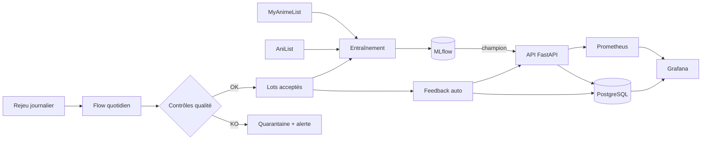

# 5MLDE : prédiction du score MyAnimeList

Projet MLOps réalisé en binôme. On essaie de prédire la note MyAnimeList d'un anime avant
sa diffusion, uniquement à partir de ce qu'on sait au moment de l'annonce : studio,
genres, tags, source, format, nombre d'épisodes, si c'est une suite, etc.

Le modèle reste simple (une Random Forest). Le travail porte surtout sur la chaîne autour :
récupération et contrôle des données, entraînement suivi dans MLflow, mise en service,
API, retour des vrais scores et supervision.

Pour aller plus loin :

- [docs/synthese-ops.md](docs/synthese-ops.md) : nos choix techniques, la gestion des pannes et les limites
- [docs/demonstration.md](docs/demonstration.md) : le déroulé de la démo
- [docs/mise-en-service.md](docs/mise-en-service.md) : alias, tags et règles de promotion du modèle
- [docs/dimensionnement.md](docs/dimensionnement.md) : tests de charge et recommandations
- [projet-mlops-anime.md](projet-mlops-anime.md) : le cadrage de départ

## Les données

Aucune donnée n'est dans le dépôt, tout est téléchargé par les scripts dans `data/`.

- **MyAnimeList** : le CSV du dépôt GitHub [meesvandongen/anime-dataset](https://github.com/meesvandongen/anime-dataset),
  téléchargé à un commit précis. C'est lui qui donne la note à prédire (`mean`).
  Le dépôt n'a pas de licence : les données appartiennent à MyAnimeList, on les utilise
  seulement pour ce projet scolaire.
- **AniList** : l'API GraphQL publique (`https://graphql.anilist.co`) pour les tags, la
  source et les liens suite/préquel. Elle est gratuite pour un usage non commercial et
  limitée en ce moment à 30 requêtes par minute ([doc](https://docs.anilist.co/guide/rate-limiting)).
  Le client respecte cette limite, réessaie en cas d'erreur et garde chaque extraction
  en cache (fichier Parquet daté).

Les deux sources sont jointes sur l'identifiant MyAnimeList. On retire volontairement les
colonnes qui dépendent du public (`rank`, `popularity`, `num_list_users`,
`num_scoring_users`), puisqu'elles ne sont pas connues avant la diffusion.

Comme le jeu MAL est figé, une petite API (`replay`) le rejoue jour par jour à partir du
1er janvier 2025. Chaque jour elle donne les animes annoncés, et le lendemain leur vraie
note. Ça nous permet de simuler l'arrivée de nouvelles données.

## Architecture



Tout tourne avec Docker Compose :

| Service | Adresse |
|---|---|
| API | http://localhost:8000/docs |
| MLflow | http://localhost:5000 |
| Prefect | http://localhost:4200 |
| Grafana | http://localhost:3000 |
| Prometheus | http://localhost:9090 |
| PostgreSQL | localhost:5432 |

La source de rejeu (port 8100) et les flows Prefect se lancent depuis la machine.

## Installation

Il faut [uv](https://docs.astral.sh/uv/) et Docker Desktop.

```bash
git clone https://github.com/EmmahusOndongo/5MLDE.git
cd 5MLDE
uv sync --locked
cp .env.example .env
```

Dans `.env`, remplacer tous les `change-me`. `ANIME_DATABASE__PASSWORD` doit être le même
que `POSTGRES_PASSWORD`. Ensuite :

```bash
docker compose up -d --build --wait
```

Les autres réglages (seuils, hyperparamètres, horaires) sont dans
[configs/config.yaml](configs/config.yaml). On peut les surcharger par variable
d'environnement, par exemple `ANIME_MODEL__N_ESTIMATORS=50`.

Attention sous Windows : si un PostgreSQL est déjà installé sur le port 5432, les
commandes lancées hors Docker s'y connectent à la place de celui du projet. Dans ce cas
changer `POSTGRES_PORT` et `ANIME_DATABASE__PORT` dans `.env`.

## Utilisation

Les commandes sont dans le `Makefile`. Sans `make` (Windows), on peut taper directement
les commandes `uv run` du tableau plus bas.

### Entraîner un modèle

```bash
make ingest   # télécharge MAL et AniList
make train    # contrôles, entraînement, MLflow, promotion
make status   # état du registre
```

Avant d'entraîner, Great Expectations contrôle MAL, AniList puis le jeu fusionné. Si un
contrôle échoue, l'entraînement s'arrête et le rapport est gardé dans
`data/reports/validation/`.

Tout est enregistré dans MLflow : version des données, commit du code, hyperparamètres,
graine, métriques et rapports. Le nouveau modèle devient `champion` s'il fait mieux que la
moyenne et au moins aussi bien que le champion actuel (règles dans
[configs/promotion.yaml](configs/promotion.yaml)). Sinon il est gardé comme `challenger`.

Sur nos données (19 340 animes notés), on obtient une MAE de 0,38 contre 0,70 en prédisant
simplement la moyenne.

Pour revenir à la version précédente :

```bash
make rollback            # ou make rollback VERSION=2
curl -X POST http://localhost:8000/admin/reload
```

### Rejeu quotidien

```bash
make replay     # dans un terminal à part
make daily      # traite le jour suivant
make pipeline   # réentraîne avec les lots acceptés
make flows      # lance la planification Prefect
```

Un lot invalide part en quarantaine, le flow échoue et une alerte est écrite dans
`data/reports/alerts.jsonl` (ou envoyée sur un webhook si `ANIME_ALERTS__WEBHOOK_URL`
est défini).

Quand un lot est accepté, ses animes sont prédits par l'API. Le lendemain, leur vraie note
est enregistrée comme feedback dans PostgreSQL et on peut comparer les deux dans Grafana.
Si l'API ou la base ne répond pas, c'est rattrapé au passage suivant (`make feedback`).

### L'API

- `POST /predict` et `POST /predict/batch` : prédiction (avec la version du modèle utilisée)
- `POST /feedback` : saisir une vraie note à la main
- `GET /health`, `GET /model`, `GET /metrics`
- `POST /admin/reload` : recharger le champion

Si PostgreSQL tombe, l'API continue de prédire mais répond `persisted=false`. Un cache
peut être activé avec `ANIME_API__CACHE_ENABLED=true`.

D'après nos tests de charge, 2 workers avec le cache suffisent jusqu'à 25 utilisateurs
simultanés, et il faut passer à 4 workers pour 50 (détails dans
[docs/dimensionnement.md](docs/dimensionnement.md)).

## Démo

Le déroulé complet est dans [docs/demonstration.md](docs/demonstration.md) :

- `make demo-nominal` : prédiction, cache, enregistrement en base, feedback
- `make demo-incident` : lot invalide mis en quarantaine
- AniList inaccessible : le pipeline se rabat sur le cache
- `make demo-postgres-incident CONFIRM_PROJECT=anime-mlops` : panne de la base
- `make rollback` : retour à la version précédente du modèle

## Tests

```bash
make lint
make test
```

Les tests tournent sans réseau ni Docker. La CI GitHub Actions lance ruff et pytest à
chaque push.

## Commandes sans make

| make | commande |
|---|---|
| `setup` | `uv sync --locked` |
| `lint` | `uv run ruff check .` et `uv run ruff format --check .` |
| `test` | `uv run pytest -m "not integration"` |
| `ingest` | `uv run python -m anime_mlops.data.ingest` |
| `train` | `uv run python -m anime_mlops.training.train` |
| `status` | `uv run python -m anime_mlops.training.promote status` |
| `rollback` | `uv run python -m anime_mlops.training.promote rollback [--version N]` |
| `replay` | `uv run uvicorn anime_mlops.replay.app:app --port 8100` |
| `daily` | `uv run python -m anime_mlops.flows.cli daily` |
| `demo-incident` | `uv run python -m anime_mlops.flows.cli daily --corrupt` |
| `pipeline` | `uv run python -m anime_mlops.flows.cli training` |
| `feedback` | `uv run python -m anime_mlops.flows.cli feedback` |
| `flows` | `uv run python -m anime_mlops.flows.cli serve` |
| `api` | `uv run uvicorn anime_mlops.api.main:app --reload` |
| `demo-nominal` | `uv run python -m anime_mlops.demos.service nominal --api-url http://127.0.0.1:8000` |
| `load-test` | `uv run --group load python -m load_tests.run_matrix` |

## Pourquoi ces choix

- **Prefect** : les flows restent du Python normal. On a les retries, les tâches en
  parallèle, la planification et l'historique des exécutions sans avoir à monter Airflow.
- **En ligne et par lot** : `/predict` pour un anime, `/predict/batch` pour une saison
  entière. Le feedback automatique utilise le mode lot.
- **Parallélisme** : les contrôles indépendants tournent en parallèle dans Prefect, la
  Random Forest utilise tous les cœurs et l'API peut avoir plusieurs workers.

Le reste est expliqué dans [docs/synthese-ops.md](docs/synthese-ops.md).
