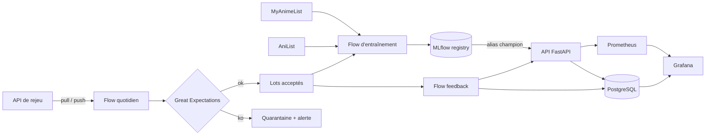

# 5MLDE - Prédiction du score MyAnimeList

Le but du projet est de prédire la note MyAnimeList d'un anime avant sa sortie, avec
seulement ce qu'on sait au moment de l'annonce (studio, genres, tags, source, format,
nombre d'épisodes, suite ou non), et de construire la chaîne MLOps complète autour :
ingestion, contrôles qualité, entraînement suivi, mise en service, API, feedback et
monitoring.

Les choix techniques, les preuves d'intégration, les résultats des tests de charge, le
dimensionnement recommandé et les limites sont détaillés dans [SYNTHESE_OPS.md](SYNTHESE_OPS.md).

## Données

Les données ne sont pas versionnées. Elles sont téléchargées par les scripts dans `data/`.

- **MyAnimeList** : CSV du dépôt [meesvandongen/anime-dataset](https://github.com/meesvandongen/anime-dataset),
  téléchargé à un commit précis (hash + SHA-256 du fichier). Il contient la note à prédire
  (`mean`). Le dépôt n'a pas de licence, les données appartiennent à MyAnimeList et ne
  sont utilisées ici que dans le cadre du cours.
- **AniList** : API GraphQL publique (`https://graphql.anilist.co`) pour les tags, la
  source et les liens suite/préquel. Usage gratuit en non commercial, limité à 30 requêtes
  par minute actuellement ([doc](https://docs.anilist.co/guide/rate-limiting)). Les
  requêtes sont faites par lots de 50, avec une pause de 2 s, des retries, et chaque
  extraction est mise en cache (Parquet daté).

Les deux sources sont jointes sur l'identifiant MyAnimeList. Les colonnes qui dépendent
du public (`rank`, `popularity`, `num_list_users`, `num_scoring_users`) sont exclues pour
éviter une fuite de données.

Le dataset étant figé, une API de rejeu (`replay`) le découpe en lots journaliers à partir
du 01/01/2025 : chaque jour, les animes annoncés (sans champ lié au public), puis le
lendemain leur vraie note. C'est ce qui alimente l'ingestion quotidienne.

## Architecture



| Service (Docker Compose) | Rôle | Adresse |
|---|---|---|
| postgres | bases `anime` (prédictions, feedbacks) et `mlflow` | localhost:5432 |
| mlflow | suivi des runs et registre de modèles | http://localhost:5000 |
| prefect | orchestration | http://localhost:4200 |
| api | prédiction, feedback, métriques | http://localhost:8000/docs |
| prefect-exporter | état des flows pour Prometheus | interne |
| prometheus | métriques | http://localhost:9090 |
| grafana | dashboard et alertes | http://localhost:3000 |

L'API de rejeu (port 8100), la réception push (port 8101) et l'exécution des flows Prefect
se lancent depuis la machine hôte.

## Installation et lancement

Prérequis : [uv](https://docs.astral.sh/uv/) et Docker.

```bash
git clone https://github.com/EmmahusOndongo/5MLDE.git
cd 5MLDE
uv sync --locked
cp .env.example .env      # puis remplacer tous les "change-me"
docker compose up -d --build --wait
```

`ANIME_DATABASE__PASSWORD` doit être égal à `POSTGRES_PASSWORD`. Les paramètres (seuils,
hyperparamètres, horaires) sont dans `configs/config.yaml` et peuvent être surchargés par
variable d'environnement, par exemple `ANIME_MODEL__N_ESTIMATORS=50`.

Sous Windows, si un PostgreSQL local occupe déjà le port 5432, changer `POSTGRES_PORT` et
`ANIME_DATABASE__PORT` dans `.env`.

## Commandes

| make | Rôle | Sans make |
|---|---|---|
| `make ingest` | télécharge MAL et AniList | `uv run python -m anime_mlops.data.ingest` |
| `make train` | contrôles, entraînement, MLflow, promotion | `uv run python -m anime_mlops.training.train` |
| `make status` | versions, alias et tags du modèle | `uv run python -m anime_mlops.training.promote status` |
| `make promote VERSION=N` | applique les règles de promotion | `uv run python -m anime_mlops.training.promote promote --version N` |
| `make rollback VERSION=N` | retour arrière du champion | `uv run python -m anime_mlops.training.promote rollback --version N` |
| `make replay` | API de rejeu (port 8100) | `uv run uvicorn anime_mlops.replay.app:app --port 8100` |
| `make receiver` | réception des lots en push (port 8101) | `uv run uvicorn anime_mlops.ingestion.receiver:app --port 8101` |
| `make daily` | traite le lot du jour suivant | `uv run python -m anime_mlops.flows.cli daily` |
| `make pipeline` | flow d'entraînement complet | `uv run python -m anime_mlops.flows.cli training` |
| `make feedback` | rattache les vraies notes aux prédictions | `uv run python -m anime_mlops.flows.cli feedback` |
| `make flows` | planification Prefect (quotidien 6h, lundi 7h) | `uv run python -m anime_mlops.flows.cli serve` |
| `make lint` | ruff | `uv run ruff check .` et `uv run ruff format --check .` |
| `make test` | tests unitaires | `uv run pytest -m "not integration"` |
| `make load-test` | tests de charge Locust | `uv run --group load python -m load_tests.run_matrix` |

## Pipeline

### Contrôles qualité

Great Expectations contrôle MAL, AniList puis le jeu fusionné avant chaque entraînement :
colonnes et types, note entre 0 et 10, doublons, valeurs manquantes, taux de jointure
MAL/AniList (au moins 80 %), catégories connues. On a ajouté des contrôles métier sur les
lots journaliers, par exemple « un anime annoncé ne doit pas être déjà connu ». Les
contrôles sont bloquants : en cas d'échec rien n'est entraîné, et un rapport JSON est
archivé dans `data/reports/validation/`.

### Entraînement et traçabilité

Le modèle est un pipeline scikit-learn : imputation, encodage, top 30 studios et top 50
tags en multi-hot, puis une Random Forest (200 arbres, profondeur 12,
`min_samples_leaf=2`, graine 42, `n_jobs=-1`). Le prétraitement fait partie du modèle,
l'API lui envoie donc les champs bruts.

Chaque run MLflow enregistre les hyperparamètres, la graine, le commit et le SHA-256 des
données MAL, la date et le SHA-256 de l'extraction AniList, le commit du code, les
métriques (MAE, RMSE, R², comparaison à la moyenne), l'erreur par catégorie, l'importance
des features et les rapports de contrôle.

Sur 19 340 animes notés : MAE de 0,38 sur le jeu de test, contre 0,70 en prédisant la
moyenne (R² = 0,65).

### Mise en service

L'API sert toujours la version qui porte l'alias `champion` du modèle
`anime-score-regressor`. Promouvoir ou revenir en arrière consiste à déplacer cet alias,
sans redéployer.

Critères d'acceptation d'une nouvelle version (`configs/promotion.yaml`) :

1. les contrôles qualité de ses données sont passés ;
2. sa MAE est meilleure que celle d'une prédiction constante (la moyenne) ;
3. sa MAE n'est pas moins bonne que celle du champion actuel.

Si les trois sont vrais, elle devient `champion` et l'ancien passe `archived`. Si seul le
3 échoue, elle devient `challenger`. Si le 1 ou le 2 échoue, elle est `rejected`.

Tags posés sur chaque version :

| Tag | Contenu |
|---|---|
| `mal_commit`, `anilist_extraction_date`, `anilist_is_fallback` | origine des données |
| `code_commit`, `code_dirty` | origine du code |
| `test_mae`, `test_rmse`, `train_rows` | performance et taille du jeu |
| `status` | `champion`, `challenger`, `rejected`, `archived` ou `rolled_back` |
| `decision_reason`, `decided_at` | raison et date de la décision |
| `replaced_version` / `rollback_from_version` | versions concernées par une promotion ou un retour arrière |

Retour arrière : `make rollback` (ou `VERSION=N`), puis `POST /admin/reload` sur l'API.

### Ingestion quotidienne

Le flow quotidien prend le lot du jour s'il a déjà été reçu en push, sinon le récupère en
pull auprès de l'API de rejeu. Les annonces et les scores sont contrôlés en parallèle. Un
lot valide est rangé dans `data/accepted/` et pourra servir à l'entraînement ; un lot
invalide va dans `data/quarantine/`, le flow échoue et une alerte est émise. Le flow
d'entraînement ne prend que les lots acceptés.

Les alertes sont écrites dans `data/reports/alerts.jsonl` et envoyées à un webhook si
`ANIME_ALERTS__WEBHOOK_URL` est défini.

### Feedback automatique

Après chaque lot accepté, les animes annoncés sont prédits par l'API (`/predict/batch`) et
le lien anime / `prediction_id` est conservé dans `data/predictions/`. Quand la vraie note
arrive le lendemain, elle est enregistrée dans la table `feedbacks` (source `automatic`).
Grafana compare ensuite prédictions et vraies notes. Si l'API ou la base est indisponible,
le flow échoue avec une alerte et le passage suivant rattrape ce qui manque, sans doublon.

## API

| Endpoint | Rôle |
|---|---|
| `POST /predict` | prédiction d'un anime |
| `POST /predict/batch` | prédiction par lot (100 max) |
| `POST /feedback` | vraie note saisie manuellement |
| `GET /health` | état du modèle et de la base |
| `GET /model` | version servie |
| `POST /admin/reload` | recharge le champion |
| `GET /metrics` | métriques Prometheus |

Chaque réponse contient le `prediction_id` et la version du modèle. Chaque prédiction est
enregistrée dans PostgreSQL (entrée, sortie, version, run MLflow, durée, erreur). Si la
base tombe, l'API continue de prédire avec `persisted=false` et `/health` passe en
`degraded`. Un cache LRU/TTL est activable (`ANIME_API__CACHE_ENABLED=true`) ; sa clé
contient la version du modèle et il est vidé à chaque rechargement.

## Monitoring

Prometheus collecte les métriques de l'API et l'état des flows Prefect. Le dashboard
Grafana (provisionné depuis `monitoring/`) affiche le débit, les latences p50/p95, les
erreurs, la version servie, l'état des flows, les prédictions comparées aux vraies notes et
la MAE observée. Trois alertes sont configurées : taux d'erreur supérieur à 5 %, p95
supérieur à 1 s, Prefect indisponible. Grafana lit PostgreSQL avec un compte en lecture
seule.

## Tests de charge et recommandation

Tests Locust avec 1, 2 et 4 workers Uvicorn, avec et sans cache, 50 utilisateurs
simultanés, aucune requête en échec. Le cache multiplie le débit par 5 environ.

| Utilisateurs simultanés | Configuration de l'API | Mesuré |
|---|---|---|
| 1 à 5 | 1 worker + cache, 2 vCPU, 512 Mo | 89,6 req/s, p95 180 ms |
| 6 à 25 | 2 workers + cache, 4 vCPU, 1 Go | 156,3 req/s, p95 390 ms |
| 26 à 50 | 4 workers + cache, 8 vCPU, 2 Go | 260,9 req/s, p95 520 ms |

Sans cache, 4 workers ne tiennent que 51,8 req/s avec un p95 de 1,6 s à 50 utilisateurs.
Mesures faites sur une seule machine (12 CPU logiques), avec 30 % de marge sur le débit.
Détail des mesures dans [SYNTHESE_OPS.md](SYNTHESE_OPS.md) et
[load_tests/mesures-2026-11-15.json](load_tests/mesures-2026-11-15.json).

## Cas d'usage simulés

| Cas | Commande | Résultat |
|---|---|---|
| Nominal | `make demo-nominal` | prédiction, cache, enregistrement en base, feedback, métriques |
| Feedback J / J+1 | `make replay`, puis `make daily` deux fois | vraies notes rattachées aux prédictions de la veille |
| Lot invalide | `make demo-incident` | lot en quarantaine, flow en échec, alerte |
| AniList indisponible | `ANIME_SOURCES__ANILIST__URL=http://127.0.0.1:9/graphql`, puis `make pipeline` | retries, repli sur le cache, alerte `warning`, entraînement terminé |
| PostgreSQL arrêté | `make demo-postgres-incident CONFIRM_PROJECT=anime-mlops` | l'API prédit toujours (`persisted=false`), `/feedback` en 503, puis retour à la normale |
| Retour arrière | `make rollback VERSION=N` puis `POST /admin/reload` | l'API sert la version restaurée |

## Tests et CI

```bash
make lint
make test
```

Les tests n'ont besoin ni du réseau ni de Docker (sources simulées, MLflow sur SQLite,
serveur Prefect temporaire, SQLite à la place de PostgreSQL). La CI GitHub Actions lance
ruff et pytest à chaque push.

## Choix techniques

- **Prefect** : les flows restent du Python testable sans serveur, avec retries par tâche,
  exécution parallèle, planification, historique et alertes, pour un seul conteneur.
  Airflow demandait plus d'infrastructure pour un projet de cette taille.
- **En ligne et par lot** : `/predict` pour un anime, `/predict/batch` pour une saison. Le
  feedback utilise le mode lot.
- **Parallélisme** : contrôle du catalogue et extraction AniList en parallèle dans le flow
  d'entraînement, contrôles des annonces et des scores en parallèle dans le flow
  quotidien, Random Forest sur tous les cœurs, plusieurs workers pour l'API.
- **PostgreSQL** : une seule base pour MLflow, les prédictions et les feedbacks, lue
  directement par Grafana.
- **Reproductibilité** : `uv.lock`, Python 3.12, graine fixe, données versionnées par
  commit et empreinte, images Docker figées, aucun secret versionné (`.env.example`).

## Limites

- Chaque version est évaluée sur son propre jeu de test ; une comparaison plus juste
  demanderait un jeu de test commun.
- Certains tags AniList sont ajoutés après la diffusion, ce qui peut laisser une petite
  fuite.
- Environ un quart du catalogue MAL (surtout clips et pubs) n'existe pas sur AniList.
- L'API de rejeu et les flows tournent sur l'hôte, pas dans Docker Compose.
- Pas d'authentification ni de TLS : le projet est prévu pour un usage local.
