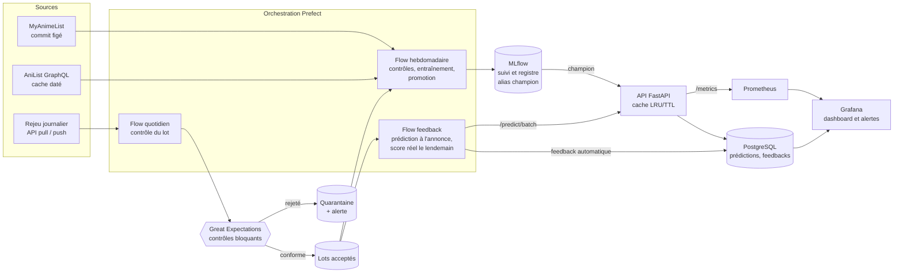

# Anime Score MLOps

Prédire la note MyAnimeList d'un anime **avant sa diffusion**, à partir de ce qui est connu
à son annonce (studio, genres, tags, source, format, nombre d'épisodes, statut de suite),
et industrialiser toute la chaîne qui produit, sert et surveille cette prédiction.

Le modèle est volontairement simple (Random Forest). La valeur du projet est la chaîne
MLOps : données versionnées, contrôles qualité bloquants, orchestration, registre de
modèles avec règles de promotion et retour arrière, API tracée, feedback automatique,
supervision et dimensionnement mesuré.

| Document | Contenu |
|---|---|
| [`docs/synthese-ops.md`](docs/synthese-ops.md) | Synthèse OPS : décisions techniques, fiabilité, preuves d'intégration, limites |
| [`docs/demonstration.md`](docs/demonstration.md) | Déroulé des démonstrations (nominal et incidents) |
| [`docs/mise-en-service.md`](docs/mise-en-service.md) | Stratégie d'alias et de tags, critères d'acceptation, retour arrière |
| [`docs/dimensionnement.md`](docs/dimensionnement.md) | Tests de charge et recommandation par nombre d'utilisateurs |
| [`monitoring/README.md`](monitoring/README.md) | Prometheus, Grafana, dashboard et alertes |
| [`load_tests/README.md`](load_tests/README.md) | Protocole de la campagne Locust |
| [`projet-mlops-anime.md`](projet-mlops-anime.md) | Cadrage initial du projet |

## Sommaire

1. [Données](#données)
2. [Architecture](#architecture)
3. [Installation](#installation)
4. [Reproduire la chaîne](#reproduire-la-chaîne)
5. [Servir et superviser](#servir-et-superviser)
6. [Démonstrations](#démonstrations)
7. [Tests et qualité](#tests-et-qualité)
8. [Choix techniques](#choix-techniques)
9. [Structure du dépôt](#structure-du-dépôt)

## Données

Aucune donnée n'est versionnée : tout est téléchargé par les scripts, dans `data/`
(ignoré par Git).

| Source | Rôle | Accès | Version utilisée |
|---|---|---|---|
| [MyAnimeList](https://myanimelist.net) via le dépôt [`meesvandongen/anime-dataset`](https://github.com/meesvandongen/anime-dataset) | Catalogue et **cible** (`mean`) | CSV brut téléchargé depuis GitHub | Hash de commit figé (40 caractères) et empreinte SHA-256 du fichier |
| [AniList](https://anilist.co), API GraphQL `https://graphql.anilist.co` | Enrichissement : tags, source, suites et préquels | Publique, sans clé, interrogée par lots de 50 identifiants MAL | Date d'extraction, cache Parquet daté et son empreinte |

Les deux sources sont jointes sur l'identifiant MyAnimeList (`idMal` côté AniList), sans
rapprochement fragile par titre. Tous les animes MAL sont conservés : environ un quart du
catalogue (clips, publicités…) n'existe pas sur AniList et reste sans enrichissement.

**Conditions d'utilisation**

- **MyAnimeList** : `meesvandongen/anime-dataset` est un projet tiers non officiel, alimenté
  par l'API MyAnimeList. Le dépôt n'indique aucune licence : les données restent la
  propriété de MyAnimeList et ne sont utilisées ici que dans un cadre pédagogique, sans
  redistribution.
- **AniList** : les [conditions d'utilisation](https://docs.anilist.co/guide/terms-of-use)
  autorisent l'usage non commercial. La [limite de requêtes](https://docs.anilist.co/guide/rate-limiting)
  est de 90 par minute, actuellement réduite à 30 : le client attend 2 secondes entre deux
  requêtes (30 par minute), réessaie sur erreur réseau, 5xx ou 429, et se replie sur le
  dernier cache si l'API reste indisponible.

**Ce que le modèle a le droit de voir.** Seules les informations connues à l'annonce sont
des features. Les indicateurs qui dépendent du public (`rank`, `popularity`,
`num_list_users`, `num_scoring_users`) sont exclus pour éviter toute fuite de données.

**Simuler l'arrivée des données.** Le jeu MAL est un instantané figé. Une petite API
(`replay`) le rejoue jour par jour à partir du 1er janvier 2025 : chaque jour, elle publie
les animes annoncés (sans aucun champ lié au public) et révèle le score réel des animes
annoncés la veille. Le pipeline récupère ces lots en *pull*, ou les reçoit en *push*.

## Architecture



| Service | Rôle | Adresse locale |
|---|---|---|
| `postgres` | Bases `anime` (prédictions, feedbacks) et `mlflow` | `localhost:5432` |
| `mlflow` | Suivi des runs, artefacts et registre de modèles | <http://localhost:5000> |
| `prefect` | Serveur d'orchestration et interface | <http://localhost:4200> |
| `api` | Prédiction en ligne et par lot, feedback, métriques | <http://localhost:8000/docs> |
| `prefect-exporter` | Expose l'état des flows Prefect à Prometheus | interne |
| `prometheus` | Collecte des métriques | <http://localhost:9090> |
| `grafana` | Dashboard « Anime MLOps — Exploitation » et 3 règles d'alerte | <http://localhost:3000> |
| `grafana-db-init` | Crée le compte PostgreSQL en lecture seule de Grafana | s'arrête après exécution |

La source de rejeu (port 8100), le point de réception *push* (port 8101) et le processus
Prefect qui exécute les flows (`flows serve`) tournent sur la machine hôte.

**Traçabilité de bout en bout.** Chaque version du modèle porte, dans MLflow, le commit MAL,
la date et l'empreinte de l'extraction AniList, le commit Git du code, les hyperparamètres,
la graine, les métriques et les rapports de contrôle qualité. Chaque réponse de l'API
donne la version servie. Chaque trace PostgreSQL garde cette version, le run MLflow,
l'entrée brute, la durée et l'éventuelle erreur. Le `prediction_id` relie enfin la
prédiction à son score réel.

## Installation

Prérequis : [uv](https://docs.astral.sh/uv/), Docker Desktop, Git. Python 3.12 est installé
par uv si besoin. `make` est facultatif : chaque cible a son équivalent `uv run`, listé
plus bas.

```bash
git clone https://github.com/EmmahusOndongo/5MLDE.git
cd 5MLDE
uv sync --locked
```

Créer le fichier `.env` (jamais versionné) à partir du modèle, puis remplacer **tous** les
mots de passe `change-me` :

```bash
cp .env.example .env
```

`ANIME_DATABASE__PASSWORD` doit être identique à `POSTGRES_PASSWORD`. Les autres réglages
(chemins, seuils, hyperparamètres, planification) sont dans [`configs/config.yaml`](configs/config.yaml)
et se surchargent par variable d'environnement : `ANIME_<SECTION>__<CLÉ>`, par exemple
`ANIME_MODEL__N_ESTIMATORS=50`.

Démarrer la stack :

```bash
docker compose up -d --build --wait
```

Sous Windows, si un PostgreSQL est déjà installé localement et écoute sur le port 5432,
les commandes lancées depuis l'hôte se connecteraient à lui. Changer alors `POSTGRES_PORT`
dans `.env` (et `ANIME_DATABASE__PORT` en conséquence).

## Reproduire la chaîne

### 1. Données et entraînement

```bash
make ingest     # télécharge MAL (commit figé) et AniList (cache daté)
make train      # contrôles qualité, entraînement, journalisation MLflow, promotion
make status     # versions, alias et tags du registre
```

`make train` enchaîne :

1. **Ingestion** de MAL au commit configuré (ou au dernier commit, alors enregistré) et
   d'AniList (cache de moins de 7 jours réutilisé, sinon nouvelle extraction).
2. **Contrôles Great Expectations bloquants** sur MAL, sur AniList, puis sur le jeu
   fusionné (taux de jointure, valeurs manquantes, bornes de la cible, catégories
   connues…). Un rapport JSON est archivé dans `data/reports/validation/` pour chaque
   contrôle ; au premier échec, rien n'est entraîné.
3. **Entraînement** d'un pipeline scikit-learn complet : imputation, encodage, top N des
   studios et tags en multi-hot, puis Random Forest (200 arbres, profondeur 12, graine 42,
   tous les cœurs utilisés).
4. **Journalisation MLflow** : paramètres, versions des données, métriques (MAE, RMSE, R²,
   comparaison à une prédiction constante), erreurs par catégorie, importance des
   features, rapports qualité et modèle.
5. **Promotion** selon [`configs/promotion.yaml`](configs/promotion.yaml) : la nouvelle
   version devient `champion` si ses données sont validées, si elle bat la prédiction
   constante et si sa MAE n'est pas moins bonne que celle du champion en place. Sinon elle
   devient `challenger`, ou `rejected` si elle ne bat pas la référence. La décision et sa
   raison sont écrites en tags de la version.

Sur l'instantané MAL utilisé (25 752 animes, 19 340 animes notés pour
l'entraînement), la MAE de test est de 0,38 contre 0,70 pour la prédiction constante
(R² = 0,65).

Retour arrière, puis rechargement du modèle par l'API :

```bash
make rollback                # vers la version remplacée par le champion actuel
make rollback VERSION=2      # ou vers une version précise
curl -X POST http://localhost:8000/admin/reload
```

### 2. Rejeu quotidien et orchestration

```bash
make replay     # terminal 1 : source simulée, http://localhost:8100/docs
make daily      # traite le lot du jour suivant (ou DAY=2025-01-05)
make pipeline   # flow d'entraînement Prefect sur l'historique + les lots acceptés
make flows      # planifie les flows (quotidien 06:00, hebdomadaire lundi 07:00)
```

Le flow quotidien prend le lot reçu en *push* s'il est déjà arrivé, sinon le récupère en
*pull*. Il contrôle en parallèle les annonces et les scores, puis range le lot dans les
lots acceptés ou en quarantaine. Un lot rejeté fait échouer le flow et émet une alerte
critique ; il n'alimente jamais l'entraînement. Un lot accepté déclenche le feedback
automatique.

Les alertes sont écrites dans `data/reports/alerts.jsonl` et, si `ANIME_ALERTS__WEBHOOK_URL`
est défini, envoyées à un webhook (Slack, Discord, Teams).

### 3. Feedback automatique

Le jour de l'annonce, chaque anime est prédit par l'API (`/predict/batch`) et son
`prediction_id` est noté dans `data/predictions/`. Quand un lot ultérieur révèle son score
réel, ce score est enregistré dans la table `feedbacks` avec la source `automatic`. Grafana
compare alors prédiction et score réel.

Le feedback ne bloque jamais l'ingestion. Si l'API ou la base est indisponible, il échoue
avec une alerte et le passage suivant rattrape ce qui manque, sans doublon :

```bash
make feedback
```

## Servir et superviser

| Endpoint | Rôle |
|---|---|
| `POST /predict` | Prédiction d'un anime ; renvoie `prediction_id`, version du modèle, `persisted`, `cached` |
| `POST /predict/batch` | Prédiction par lot (100 animes au plus par défaut) |
| `POST /feedback` | Score réel saisi manuellement pour une prédiction |
| `GET /health` | État du modèle et de PostgreSQL (`ok` ou `degraded`) |
| `GET /model` | Version servie |
| `POST /admin/reload` | Recharge l'alias `champion` sans couper le service |
| `GET /metrics` | Métriques Prometheus |

L'API reste disponible si PostgreSQL tombe : elle prédit avec `persisted=false` et
`/health` signale l'état dégradé. Le cache, désactivé par défaut, s'active avec
`ANIME_API__CACHE_ENABLED=true` ; ses clés incluent la version du modèle, et il est vidé à
chaque rechargement.

Le dashboard Grafana montre le débit, les latences p50/p95, les erreurs, la version servie,
l'état des flows Prefect, et les prédictions comparées aux scores réels. Trois alertes sont
provisionnées : taux d'erreurs supérieur à 5 %, latence p95 supérieure à 1 seconde,
orchestrateur Prefect indisponible.

**Dimensionnement recommandé** (mesuré, détails dans [`docs/dimensionnement.md`](docs/dimensionnement.md)) :

| Utilisateurs simultanés | Configuration de l'API | Mesure |
|---|---|---|
| Jusqu'à 25 | 2 workers, cache activé, 4 vCPU, 1 Gio | 156 req/s, p95 390 ms, 0 échec |
| Jusqu'à 50 | 4 workers, cache activé, 8 vCPU, 2 Gio | 261 req/s, p95 520 ms, 0 échec |

```bash
uv sync --locked --group load
make load-test   # matrice 1/2/4 workers, cache désactivé/activé, dans une stack isolée
```

## Démonstrations

Le déroulé complet est dans [`docs/demonstration.md`](docs/demonstration.md).

| Scénario | Commande | Résultat attendu |
|---|---|---|
| Nominal | `make demo-nominal` | prédictions, version servie, cache, persistance, feedback, métriques |
| Feedback J puis J+1 | `make daily`, `make daily`, `make feedback` | feedbacks `automatic` en base et dans Grafana |
| Lot invalide | `make demo-incident` | lot en quarantaine, flow en échec, alerte critique |
| AniList indisponible | `ANIME_SOURCES__ANILIST__URL` vers une adresse injoignable, puis `make pipeline` | nouvelles tentatives, repli sur le cache, alerte `warning`, entraînement terminé |
| PostgreSQL arrêté | `make demo-postgres-incident CONFIRM_PROJECT=anime-mlops` | prédiction en `200` avec `persisted=false`, `/feedback` en `503`, puis rétablissement |
| Retour arrière | `make rollback VERSION=N` puis `/admin/reload` | l'API sert la version restaurée |

## Tests et qualité

```bash
make lint       # ruff : analyse statique et formatage
make test       # tests unitaires, sans la stack Docker
```

Les tests n'utilisent ni réseau ni stack Docker : sources simulées, MLflow sur SQLite,
serveur Prefect temporaire, PostgreSQL remplacé par SQLite. La CI GitHub Actions
([`.github/workflows/ci.yml`](.github/workflows/ci.yml)) exécute `uv sync --locked`, ruff
et pytest à chaque push et pull request.

### Commandes sans `make`

| `make` | Équivalent |
|---|---|
| `setup` | `uv sync --locked` |
| `lint` | `uv run ruff check .` puis `uv run ruff format --check .` |
| `test` | `uv run pytest -m "not integration"` |
| `up` / `down` | `docker compose up -d --build --wait` / `docker compose down` |
| `ingest` | `uv run python -m anime_mlops.data.ingest` |
| `train` | `uv run python -m anime_mlops.training.train` |
| `status` | `uv run python -m anime_mlops.training.promote status` |
| `promote` | `uv run python -m anime_mlops.training.promote promote [--version N]` |
| `rollback` | `uv run python -m anime_mlops.training.promote rollback [--version N]` |
| `replay` | `uv run uvicorn anime_mlops.replay.app:app --port 8100` |
| `receiver` | `uv run uvicorn anime_mlops.ingestion.receiver:app --port 8101` |
| `daily` | `uv run python -m anime_mlops.flows.cli daily [--day AAAA-MM-JJ]` |
| `demo-incident` | `uv run python -m anime_mlops.flows.cli daily --corrupt` |
| `pipeline` | `uv run python -m anime_mlops.flows.cli training` |
| `feedback` | `uv run python -m anime_mlops.flows.cli feedback` |
| `flows` | `uv run python -m anime_mlops.flows.cli serve` |
| `api` | `uv run uvicorn anime_mlops.api.main:app --reload` |
| `register-mock-model` | `uv run python -m anime_mlops.api.register_mock_model` |
| `demo-nominal` | `uv run python -m anime_mlops.demos.service nominal --api-url http://127.0.0.1:8000` |
| `demo-postgres-incident` | `uv run python -m anime_mlops.demos.service postgres-outage --api-url http://127.0.0.1:8000 --project-name anime-mlops --confirm-project anime-mlops` |
| `load-test` | `uv run --group load python -m load_tests.run_matrix` |

## Choix techniques

**Pourquoi Prefect ?** Les flows restent du Python ordinaire, testable sans serveur. Prefect
apporte ce qu'il faut à une chaîne qui dépend de sources externes : nouvelles tentatives
par tâche, exécution parallèle des branches indépendantes, planification, historique des
exécutions, rapports de contrôle dans l'interface et crochets d'alerte en cas d'échec. Il
tourne en un seul conteneur, plus léger qu'Airflow pour un projet de cette taille.

**En ligne ou par lot ?** Les deux. L'API répond en ligne (`/predict`) pour un anime qui
vient d'être annoncé et propose `/predict/batch` pour une saison entière. Le feedback
automatique utilise le mode lot.

**Ce qui est parallélisé.** Contrôle du catalogue et extraction AniList dans le flow
d'entraînement, contrôle des annonces et des scores dans le flow quotidien, apprentissage
de la Random Forest sur tous les cœurs (`n_jobs=-1`), workers Uvicorn de l'API.

Les autres décisions (registre, persistance, cache, supervision) et leurs compromis sont
dans [`docs/synthese-ops.md`](docs/synthese-ops.md).

## Structure du dépôt

```text
configs/              configuration (config.yaml) et règles de promotion
docker/               images MLflow et API, initialisation PostgreSQL
docs/                 synthèse OPS, démonstrations, mise en service, dimensionnement
load_tests/           campagne Locust
monitoring/           Prometheus, Grafana (dashboard, sources, alertes)
src/anime_mlops/
  data/               sources MAL et AniList, ingestion, contrôles, jointure
  features/           features connues avant diffusion
  training/           entraînement, évaluation, promotion et retour arrière
  replay/             source simulée qui rejoue le catalogue jour par jour
  ingestion/          réception push, client pull, zone de dépôt
  pipeline/           étapes du flow quotidien, indépendantes de Prefect
  flows/              flows Prefect et ligne de commande
  feedback/           feedback automatique
  api/                API FastAPI, persistance, cache, métriques
  monitoring/         exporteur Prefect pour Prometheus
  demos/              scripts des démonstrations
tests/unit/           tests unitaires
```
